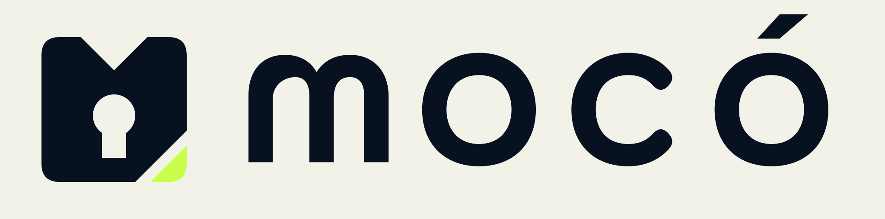

# Mocó identity

Mocó manages application secrets. Its icon combines a vault with an M-shaped
upper edge, a keyhole cut out of the body, and a signal-colored latch at the
lower right. The keyhole remains transparent in every color variant, including
monochrome, so the mark stays recognizable on light and dark surfaces.

The horizontal logo pairs the icon with custom lowercase `mocó` lettering.
Every letter and the acute accent is an original filled vector path. There are
no live text elements, embedded fonts, linked images or raster artwork.
The canonical product ID and file paths use `moco`; the display name is `Mocó`.



## Palette

The identity uses the repository's semantic palette from `manifests/brand.yaml`:

| Role | Light | Dark |
| --- | --- | --- |
| Vault and wordmark, ink | `#07111f` | `#f3f2e9` |
| Latch, signal | `#c7ff4a` | `#c7ff4a` |
| Plated background, surface | `#f3f2e9` | `#07111f` |

The generator also produces adaptive, grayscale, tinted and monochrome
variants. Adaptive files follow the existing `--araihu-logo-surface`,
`--araihu-logo-ink` and `--araihu-logo-signal` contract. Monochrome variants use
`currentColor` while preserving the keyhole through even-odd path geometry.

## Sources and generated files

Four SHA-256-pinned masters live under `source/brand/original/`:

- `moco-icon-transparent.svg`
- `moco-icon-background.svg`
- `moco-logo-transparent.svg`
- `moco-logo-background.svg`

The icon uses a 1024-square canvas; the horizontal logo uses 2048 × 508.
Optical framing and launcher safe areas come from the shared transform pipeline.
The lettering is part of the logo geometry and needs no installed typeface.

Use generated files through `catalog.json`, rather than importing source masters:

| Use | Generated path |
| --- | --- |
| Light icon | `icons/brand/moco-icon-light-transparent-optical.svg` |
| Dark icon | `icons/brand/moco-icon-dark-transparent-optical.svg` |
| Monochrome icon | `icons/brand/moco-icon-monochrome-transparent-optical.svg` |
| Adaptive launcher | `icons/brand/moco-icon-adaptive-plate-launcher.svg` |
| Light logo | `brand/moco/logo/light-transparent-optical.svg` |
| Dark logo | `brand/moco/logo/dark-transparent-optical.svg` |
| Web favicon and PWA assets | `platform/web/moco/` |
| Android launcher assets | `platform/android/moco/` |
| Apple app icon set | `platform/apple/moco/` |

The catalog records each generated file's hash, palette, framing, license and
sprite symbol. Adaptive SVGs remain individual files under the shared contract.

## Review and validation

`site/proof/scenarios.json` includes 49 Mocó scenarios covering transparent and
plated variants, optical and launcher framing, and circle and squircle masks.
The generated `dist/proof/` includes the identity alongside the other products.
Review the icon at 16, 20, 24, 32, 48, 64, 128 and 512 px, including the keyhole
and latch, before changing the source geometry.

```sh
make generate
make check
make proof-check
make verify
```

These commands require the repository-pinned `rsvg-convert` 2.62.1 for platform
rasters and reproducibility checks. Release v0.2.6 distributes this identity.
Consumers must pin that release or
a newer one and verify the archive and catalog checksums before importing
files. The existing v0.2.5 archive and the independently promoted default
channel remain unchanged.
